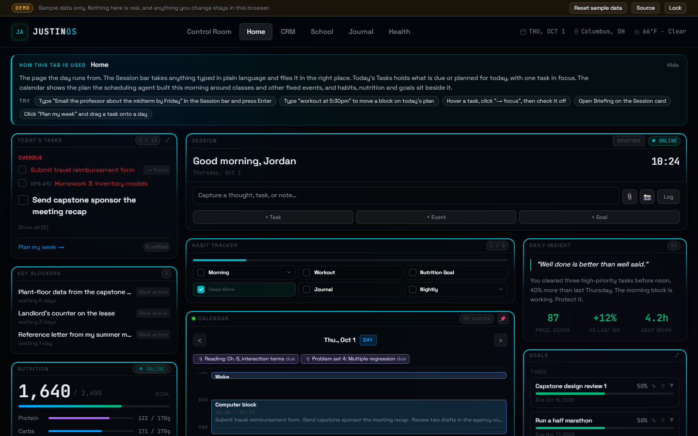
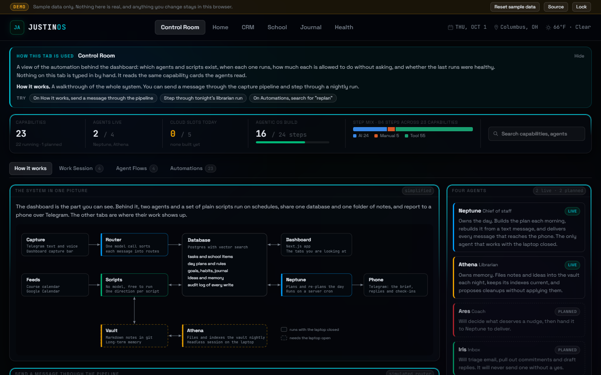
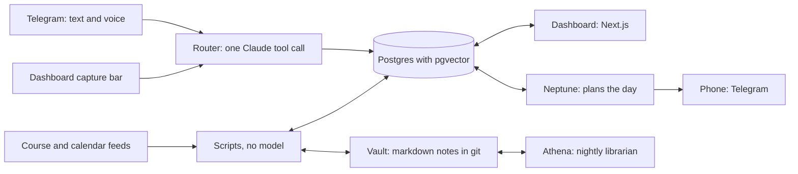
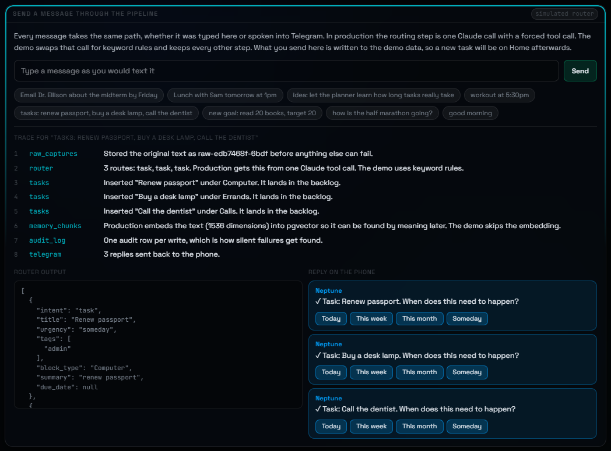
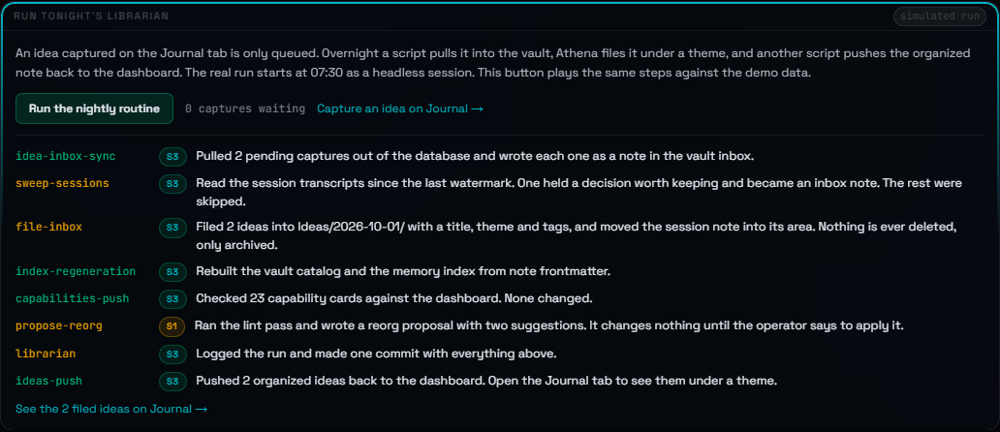
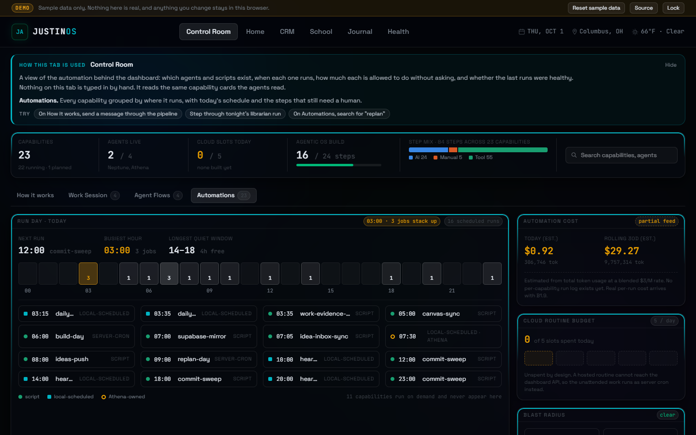

# JustinOS demo

JustinOS is the dashboard and agent system I built to run my days as an engineering student. It holds my tasks, classes, daily plan, habits, journal and a small side business. The real one is private because it is full of my actual life. This repository is the same interface running on invented data, entirely in your browser, so you can click through it the way I use it.

Live demo: https://steinberger528.github.io/Justinos-demo/

The password is `password`.



## What to try

It takes about two minutes.

1. Sign in with `password`. The real dashboard sits behind the same screen.
2. On Home, type `Email the professor about the midterm by Friday` into the Session bar and press Enter. A task appears, and the reply that would normally go to my phone shows up in the corner of the page.
3. Open Control Room. Its first section, How it works, lets you send a message through the capture pipeline and watch each step. You can also run the nightly filing routine from there.
4. On CRM, open Workday and approve a decision or resolve an escalation.
5. Click "Reset sample data" in the top bar to put everything back.

Every tab has a note at the top that says what the tab is for and lists a few things to try.

## The tabs

| Tab | What it is for |
|---|---|
| Control Room | The automation behind the dashboard: which agents and scripts exist, when each one runs, how much each may do without asking, and whether the last runs were healthy. |
| Home | The page the day runs from. A capture bar, today's tasks, the plan for the day on a calendar, habits, nutrition and goals. |
| CRM | The cockpit for a content agency I am building, where specialist agents do the drafting and research and a person reviews and approves. |
| School | Everything with a due date across every course, with a countdown and a topic checklist for each exam. |
| Journal | Raw ideas that get filed overnight, and one journal entry a day with a mood. |
| Health | A placeholder. The health pieces that exist today live on Home. |

The Settings page (the avatar in the top left) holds the rules the morning plan is built around.

## How the real system works





The dashboard is the visible part. Behind it, two agents and a set of plain scripts run on schedules, share one database and one folder of notes, and report to my phone over Telegram.

### One path for every capture

Anything I type into the dashboard or send to the Telegram bot, by text or by voice, goes through the same pipeline:

1. The raw text is stored first, before anything else can fail.
2. One Claude call with a forced tool call sorts the message into routes. A message with three things in it becomes three routes.
3. Each route is written to its table: a task, a calendar event, a goal update, an idea, a note.
4. The text is embedded into pgvector so it can be found by meaning later.
5. An audit row is written.
6. The bot replies on my phone, with buttons when it needs one more answer.



### A plan for the day

Neptune is the agent that owns the day. Each morning a server cron gathers my rules, fixed events and open tasks, makes one model call to place the day, checks the result in code, and sends the plan to my phone with a few questions. During the day I can text a change. A simple move such as `workout at 6pm` is applied in code with no model call. Anything bigger gets one model call, with a daily cap.

### Notes that file themselves

Long-term memory is a folder of markdown notes in a private git repository. Athena, the librarian agent, runs each night as a headless Claude Code session on my laptop. It files new notes and ideas under the right theme, rebuilds the indexes, and writes a cleanup proposal that waits for my yes. Separate one-way scripts sync the database and the notes, one for each direction, so there is no live two-way link that can fall out of step.



### Two dials on every automation

Each automation is described by a capability card, and each card sets two things.

The first is where it runs. A script is used when no judgment is needed. A local session is used when the work touches local files. A server run is paid for only when the work has to happen with the laptop closed.

The second is how much it may do alone. S1 suggests and a person does the work. S2 proposes one action and waits for a yes. S3 acts without asking. Sending email, deleting notes and anything involving money never reach S3. A capability moves up a level on logged evidence, never on a schedule.

There are 23 capability cards today. Two of the four planned agents are live.



### Rules the code is held to

- Page loads never call a model. Only a schedule or an explicit refresh does, so opening the dashboard costs nothing.
- Every write adds an audit row. That is how silent failures get found.
- Errors are surfaced. An empty catch block is treated as a bug.
- The database denies every client by default. All access is from the server with a service key that never reaches the browser.
- The session cookie is signed with HMAC-SHA256 and checked on every request.

## What is real in this demo and what is simulated

| Part | In production | In this demo |
|---|---|---|
| Interface | React components, layouts, drag and drop, optimistic updates with rollback | The same components, with small edits for the demo |
| API and database | Next.js route handlers over Postgres | A wrapper around `fetch` that answers `/api/*` from a small database kept in localStorage |
| Message routing | One Claude call with a forced tool call | Keyword rules |
| Replies | Telegram messages to my phone | Notes in the corner of the page |
| Day plan | Built each morning by a model call and checked in code | Written as sample data. Single-block moves work. |
| Nightly librarian | A headless Claude Code session over the notes vault | A scripted run of the same steps against the sample data |
| Sign-in | A signed cookie checked by middleware on every request | A flag in localStorage. The password check runs in the page. |
| Voice and photo capture | Transcription and image reading on the server | Switched off |
| Embeddings | Written on every capture | Skipped |
| Weather | The browser's location and Open-Meteo | Open-Meteo for one fixed city |
| Control Room | Reads the capability cards pushed from the notes vault | A capability list modeled on the real one. Token, cost and session numbers are invented. |
| Control Room walkthrough | Does not exist. The other three sections are the production pages. | The "How it works" section, written for the demo |

Every name, number and date in the demo is invented. The operator, the courses, the clients and the journal entries are all fictional.

Anything you change is saved in your own browser, and "Reset sample data" clears it. The only request that leaves the page is the weather lookup for the top bar.

## What is not in this repository

The production backend is left out on purpose: the API routes, the capture pipeline, the planner, the agent prompts, the database migrations, the cron handlers and the notes vault. They hold real schedules and personal details, and they need keys and services that a public demo should not have. The Brain tab from the working app is also gone, because I do not use it.

## How the demo works

The app is a static export. There is no server.

- `lib/demo/install.ts` wraps `window.fetch`. Requests to `/api/*` never leave the page. They are handed to route handlers that run in the browser.
- `lib/demo/routes/` holds those handlers, about sixty of them, with the same request and response shapes the components expect.
- `lib/demo/db.ts` is the database: one object in localStorage. It is seeded relative to today's date, so "due today" is always today, and it is seeded again when the date changes.
- `lib/demo/seed/` is the sample data.
- `lib/demo/capture.ts` is the stand-in for the capture pipeline. It keeps every step of the real one and swaps the model call for keyword rules.
- `lib/demo/librarian.ts` plays the nightly run.
- `lib/demo/guides.ts` holds the note at the top of each tab.

Two places worth reading if you want to see how the interface handles state: `components/dashboard/TasksCard.tsx` for optimistic updates with rollback, and `components/dashboard/TaskPlanner.tsx` for the drag and drop week planner.

## Run it locally

You need Node 20.9 or newer.

```bash
npm install
npm run dev
```

Then open http://localhost:3000 and sign in with `password`.

To build the static export and serve it the way GitHub Pages does:

```bash
npm run build
npm run preview
```

Pushing to `main` builds and publishes the site with the workflow in `.github/workflows/deploy.yml`.

## Stack

The demo uses Next.js 16 (App Router, static export), React 19, TypeScript in strict mode, Tailwind CSS 4 and dnd-kit.

Production adds Supabase (Postgres with pgvector), the Anthropic API for routing and planning, OpenAI for voice transcription and embeddings, the Telegram Bot API, Google Calendar, Vercel for hosting and cron, and Claude Code for the scheduled agent sessions.

## How it was built

I build JustinOS with Claude Code. Each feature starts as a written spec. It then goes through a build and review loop, where a code review agent and a QA agent each report pass or fail before anything ships. This demo was put together the same way from the production interface.

## About

Built by Justin ([@steinberger528](https://github.com/steinberger528)).

The code is public so it can be read. It does not have an open source license.
